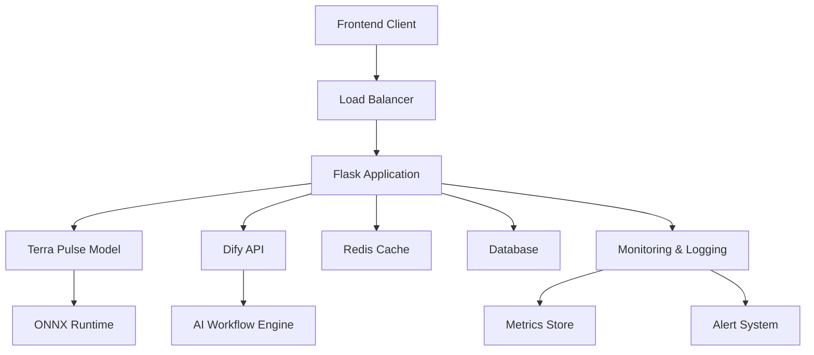
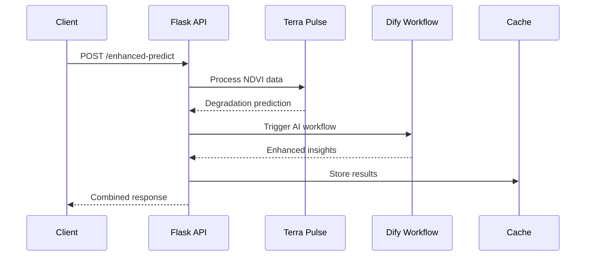
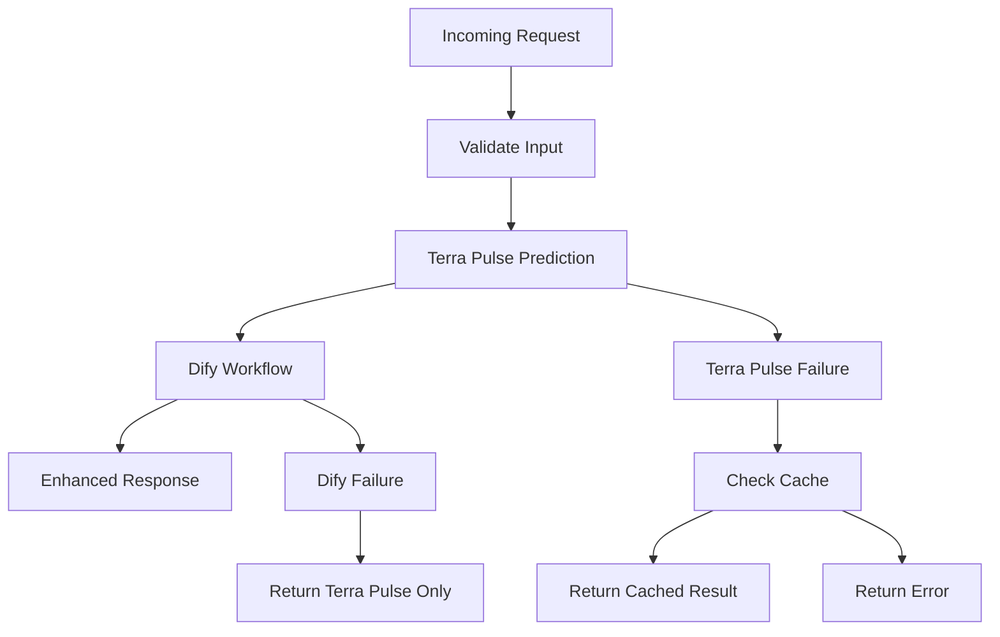

# Design Document

## Overview

The Terra Pulse-Dify Integration system will extend the existing Flask-based Terra Pulse API to seamlessly integrate with Dify's workflow API. The system will act as an intelligent middleware that processes land degradation predictions through AI-powered workflows, providing enhanced insights for different user personas (farmers and land management officials).

The integration will maintain the existing `/predict` endpoint while adding new enhanced endpoints that leverage Dify's AI capabilities. The architecture follows a microservices approach with clear separation of concerns, robust error handling, and comprehensive monitoring.

## Architecture

### High-Level Architecture



### Service Layer Architecture

The system will be organized into distinct service layers:

1. **API Layer**: Flask routes and request handling
2. **Integration Layer**: Terra Pulse and Dify API clients
3. **Processing Layer**: Data transformation and workflow orchestration
4. **Persistence Layer**: Caching and data storage
5. **Monitoring Layer**: Logging, metrics, and health checks

### Data Flow



## Components and Interfaces

### Core Components

#### 1. Enhanced Flask Application (`app.py`)
- Extends existing Flask app with new integration endpoints
- Maintains backward compatibility with current `/predict` endpoint
- Implements middleware for authentication, logging, and error handling

#### 2. Dify Integration Service (`services/dify_service.py`)
- Handles all communication with Dify API
- Manages workflow execution and result processing
- Implements retry logic and error handling

#### 3. Terra Pulse Service (`services/terra_service.py`)
- Abstracts existing ONNX model functionality
- Provides consistent interface for prediction processing
- Handles model loading and inference

#### 4. Data Processing Service (`services/data_processor.py`)
- Transforms Terra Pulse predictions for Dify consumption
- Merges AI insights with original predictions
- Formats responses for different user types

#### 5. Configuration Manager (`config/settings.py`)
- Manages environment variables and API credentials
- Provides configuration validation and defaults
- Supports runtime configuration updates

#### 6. Cache Manager (`services/cache_service.py`)
- Implements Redis-based caching for predictions
- Manages cache invalidation and TTL policies
- Provides fallback mechanisms for cache failures

### API Interfaces

#### Enhanced Prediction Endpoint
```python
POST /enhanced-predict
Content-Type: application/json

{
    "NDVI_mean_early": 0.45,
    "NDVI_median_early": 0.43,
    "NDVI_std_early": 0.12,
    "NDVI_mean_late": 0.38,
    "NDVI_median_late": 0.36,
    "NDVI_std_late": 0.15,
    "NDVI_delta_mean": -0.07,
    "location": "Baringo County, Kenya",
    "user_context": "smallholder_farmer",
    "user_type": "farmer"  // or "official"
}
```

#### Response Format
```python
{
    "terra_pulse_prediction": {
        "location": "Baringo County, Kenya",
        "degradation_risk": 75,
        "risk_factors": ["bare_soil_increase", "low_ndvi"],
        "recommended_action_key": "mulch_crop_residue",
        "confidence": 0.85,
        "user_context": "smallholder_farmer"
    },
    "ai_insights": {
        "enhanced_recommendations": [
            "Apply crop residue mulch within 2 weeks",
            "Consider drought-resistant maize varieties",
            "Implement contour farming on slopes"
        ],
        "risk_assessment": "High degradation risk due to recent drought conditions",
        "timeline": "Immediate action required within 14 days",
        "cost_estimate": "Low cost - use existing crop residue",
        "success_probability": 0.78
    },
    "formatted_response": {
        "farmer_message": "Your field shows high erosion risk. Apply crop residue mulch this week to protect soil.",
        "technical_details": "NDVI decline of 15% indicates significant vegetation stress..."
    },
    "metadata": {
        "processing_time": 1.2,
        "dify_workflow_id": "workflow_123",
        "cache_hit": false,
        "timestamp": "2024-10-13T10:30:00Z"
    }
}
```

#### Health Check Endpoints
```python
GET /health/terra-pulse    # Terra Pulse model status
GET /health/dify          # Dify API connectivity
GET /health/system        # Overall system health
GET /metrics              # Prometheus metrics
```

## Data Models

### Prediction Request Model
```python
class PredictionRequest:
    ndvi_mean_early: float
    ndvi_median_early: float
    ndvi_std_early: float
    ndvi_mean_late: float
    ndvi_median_late: float
    ndvi_std_late: float
    ndvi_delta_mean: float
    location: str
    user_context: str
    user_type: str  # "farmer" or "official"
```

### Dify Workflow Input Model
```python
class DifyWorkflowInput:
    degradation_risk: int
    risk_factors: List[str]
    location: str
    user_context: str
    confidence: float
    recommended_action_key: str
    additional_context: Dict[str, Any]
```

### Enhanced Response Model
```python
class EnhancedPredictionResponse:
    terra_pulse_prediction: Dict[str, Any]
    ai_insights: Dict[str, Any]
    formatted_response: Dict[str, str]
    metadata: Dict[str, Any]
```

### Configuration Model
```python
class AppConfig:
    terra_pulse_model_path: str
    dify_api_key: str
    dify_api_endpoint: str
    dify_workflow_id: str
    redis_url: str
    cache_ttl: int
    max_retries: int
    timeout_seconds: int
```

## Error Handling

### Error Categories and Responses

#### 1. Validation Errors (400)
- Invalid NDVI values
- Missing required fields
- Malformed request data

#### 2. Authentication Errors (401)
- Invalid API keys
- Expired tokens
- Missing authentication headers

#### 3. External Service Errors (502/503)
- Dify API unavailable
- Terra Pulse model loading failures
- Network connectivity issues

#### 4. Rate Limiting (429)
- Too many requests per minute
- Dify API quota exceeded

#### 5. Internal Errors (500)
- Unexpected processing failures
- Database connection issues
- Cache service failures

### Fallback Strategies



### Retry Logic
- Exponential backoff for external API calls
- Maximum 3 retry attempts
- Circuit breaker pattern for repeated failures
- Graceful degradation when services are unavailable

## Testing Strategy

### Unit Testing
- **Service Layer Tests**: Mock external APIs and test business logic
- **Data Processing Tests**: Validate data transformations and formatting
- **Configuration Tests**: Verify environment variable handling
- **Cache Tests**: Test caching mechanisms and fallback behavior

### Integration Testing
- **API Endpoint Tests**: Test complete request/response cycles
- **External Service Tests**: Verify Dify API integration with test workflows
- **Database Tests**: Validate data persistence and retrieval
- **Error Handling Tests**: Simulate various failure scenarios

### Performance Testing
- **Load Testing**: Simulate concurrent requests to identify bottlenecks
- **Stress Testing**: Test system behavior under extreme load
- **Latency Testing**: Measure response times for different scenarios
- **Memory Testing**: Monitor memory usage and potential leaks

### Security Testing
- **Authentication Tests**: Verify API key validation and security
- **Input Validation Tests**: Test against malicious input data
- **Rate Limiting Tests**: Verify protection against abuse
- **Data Encryption Tests**: Ensure sensitive data protection

### Monitoring and Observability

#### Logging Strategy
- **Structured Logging**: JSON format with consistent fields
- **Log Levels**: DEBUG, INFO, WARN, ERROR, CRITICAL
- **Request Tracing**: Unique request IDs for tracking
- **Performance Logging**: Response times and resource usage

#### Metrics Collection
- **Application Metrics**: Request counts, response times, error rates
- **Business Metrics**: Prediction accuracy, user engagement
- **Infrastructure Metrics**: CPU, memory, disk usage
- **External Service Metrics**: API response times and availability

#### Health Monitoring
- **Liveness Probes**: Basic application health checks
- **Readiness Probes**: Service dependency validation
- **Custom Health Checks**: Terra Pulse model and Dify API status
- **Alerting Rules**: Automated notifications for critical issues

### Deployment Architecture

#### Environment Configuration
- **Development**: Local Flask server with mock Dify responses
- **Staging**: Full integration with Dify test environment
- **Production**: Optimized deployment with monitoring and scaling

#### Scalability Considerations
- **Horizontal Scaling**: Multiple Flask instances behind load balancer
- **Caching Strategy**: Redis cluster for high availability
- **Database Optimization**: Connection pooling and query optimization
- **CDN Integration**: Static asset delivery and API response caching